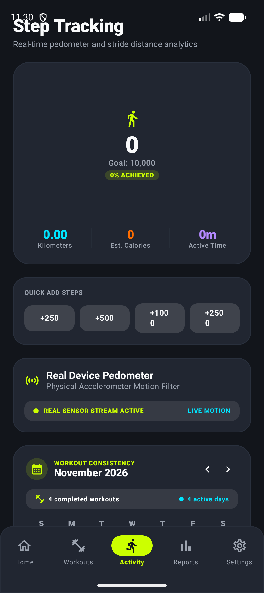
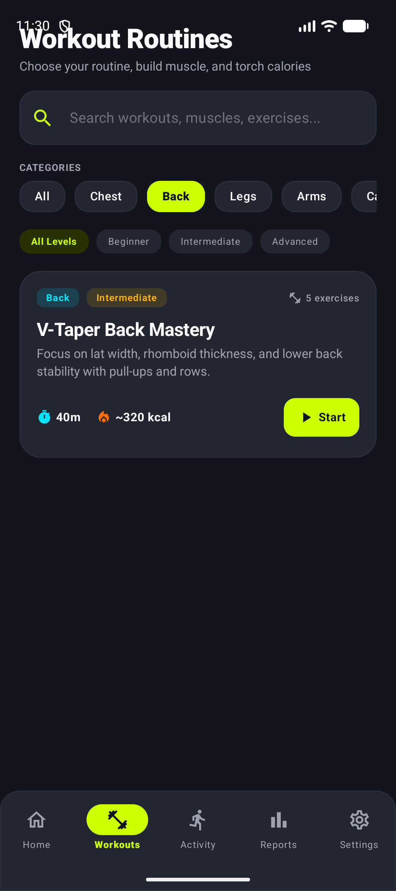
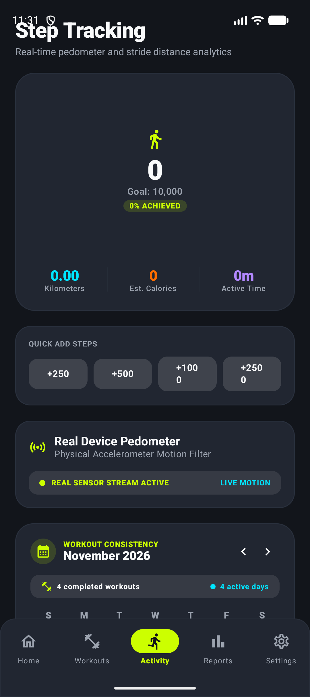
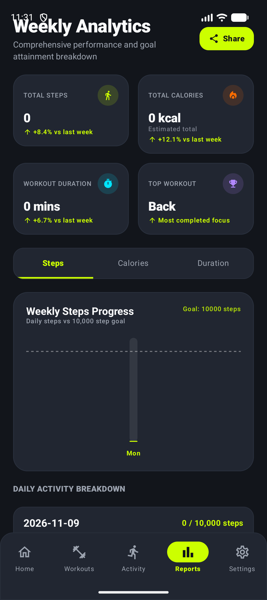
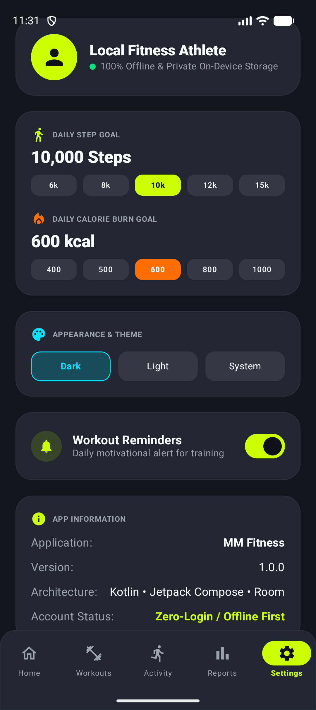

<div align="center">

  <h1>🔥 MM Fitness Tracker (PulseFit)</h1>
  <p><b>Next-Gen AI-Powered Fitness, Workout & Step Tracker Android App</b></p>

  <p>
    <a href="https://kotlinlang.org"></a>
    <a href="https://developer.android.com/jetpack/compose"></a>
    <a href="https://m3.material.io"></a>
    <a href="https://deepmind.google/technologies/gemini/"></a>
    <a href="https://github.com/omsoni21/fitnesstracker/raw/main/apk/mm-fitness-v1.0.apk"></a>
  </p>

  <br/>
  
  <a href="https://github.com/omsoni21/fitnesstracker/raw/main/apk/mm-fitness-v1.0.apk">
    
  </a>

</div>

---

## ⚡ Direct APK Download

Ready to test on your phone? Download the compiled APK file directly:

| 📱 Version | 💾 File Size | 🔗 Download Link |
| :--- | :--- | :--- |
| **v1.0-Debug** | ~27.3 MB | 📥 **[Download MM Fitness v1.0 APK](https://github.com/omsoni21/fitnesstracker/raw/main/apk/mm-fitness-v1.0.apk)** |

---

## 📱 App Screenshots & UI Showcase

<div align="center">
  <table>
    <tr>
      <td align="center"><b>🏠 Home Dashboard</b></td>
      <td align="center"><b>💪 Workout Routines</b></td>
      <td align="center"><b>🏃 Live Pedometer</b></td>
    </tr>
    <tr>
      <td></td>
      <td></td>
      <td></td>
    </tr>
    <tr>
      <td align="center"><b>📊 Reports & Calendar</b></td>
      <td align="center"><b>⚙️ Settings & Goals</b></td>
      <td align="center"><b>🤖 AI Coach</b></td>
    </tr>
    <tr>
      <td></td>
      <td></td>
      <td></td>
    </tr>
  </table>
</div>

---

## ✨ Key Features

### 🏃 Real-Time Accelerometer Pedometer
* **Sensor Motion Filter:** Tracks physical steps using device accelerometer hardware.
* **Metric Engine:** Instant calculations for total distance in Kilometers, Estimated Calories Burned, and Active Exercise Duration.
* **Quick Add Simulation:** Test and simulate step progress directly (+250, +500, +1000 steps).

### 💪 Interactive Workout Routines
* **Targeted Muscle Groups:** Custom routines for Chest, Back, Legs, Arms, and Cardio.
* **Difficulty Categorization:** Filter workouts by Beginner, Intermediate, and Advanced skill levels.
* **Guided Motion Visualizer:** Live interactive timer, rep counter, animated exercise form guide, and burn estimate.

### 🤖 Google Gemini AI Coaching
* **Personalized Recommendations:** Smart AI insights generated based on user activity logs.
* **Recovery & Hydration Advice:** Dynamic fitness guidance powered by Google Gemini (`firebase-ai`).

### 📊 Consistency & Monthly Reports
* **Interactive Calendar View:** Monthly workout tracking with active day counters and completed session history.
* **Weekly Bar Charts:** Visual breakdown of daily step achievements vs target step goals.

### ⚙️ Customizable Experience
* **Custom Step Goal:** Adjust daily step targets (e.g. 10,000 steps).
* **Modern Dark UI:** Premium dark theme crafted with Jetpack Compose & Material 3 design tokens.

---

## 🛠️ Architecture & Tech Stack

The app follows **Android Official Architecture Guidelines** (Clean Architecture + MVVM + Unidirectional Data Flow):

```text
 ┌─────────────────────────────────────────────────────────┐
 │                   UI Layer (Jetpack Compose)            │
 │     HomeScreen  │  WorkoutsScreen  │  ActivityScreen    │
 └────────────────────────────┬────────────────────────────┘
                              │ Exposes UI State (StateFlow)
 ┌────────────────────────────▼────────────────────────────┐
 │                  ViewModel Layer (MVVM)                 │
 │     HomeViewModel │ WorkoutsViewModel │ ActivityVM      │
 └────────────────────────────┬────────────────────────────┘
                              │ Calls Use Cases / Repositories
 ┌────────────────────────────▼────────────────────────────┐
 │                      Data Layer                         │
 │   FitnessRepository │ UserPreferences │ Room Database   │
 └─────────────────────────────────────────────────┘
```

| Domain | Technology / Library |
| :--- | :--- |
| **Language** | Kotlin 100% |
| **UI Framework** | Jetpack Compose + Material 3 Design |
| **Concurrency** | Kotlin Coroutines & Flow |
| **Database** | Room Database (KSP) |
| **Preferences** | Jetpack DataStore Preferences |
| **AI Services** | Google Gemini API (`firebase-ai`) |
| **Networking** | Retrofit 2 + Moshi Codegen |
| **Build Tooling** | Gradle Kotlin DSL (`build.gradle.kts`) & Version Catalog |

---

## 🚀 Quick Setup & Installation

### Option 1: Direct APK Install (Fastest)
1. Download [`mm-fitness-v1.0.apk`](https://github.com/omsoni21/fitnesstracker/raw/main/apk/mm-fitness-v1.0.apk) on your Android device.
2. Tap the downloaded file to install (allow "Install from unknown sources" if prompted).
3. Open **PulseFit MM Fitness** and enjoy!

### Option 2: Build From Source

#### Prerequisites
* **Android Studio:** Ladybug (2024.2.1+) or newer
* **JDK:** Java 11 or Java 17
* **Android SDK:** Target API Level 35/36

#### Setup Commands

```bash
# 1. Clone the repository
git clone https://github.com/omsoni21/fitnesstracker.git
cd fitnesstracker

# 2. Configure Environment Variables
cp .env.example .env
# Optional: Add your GEMINI_API_KEY inside .env for AI features
```

#### Build & Run Commands

| Task | Terminal Command | Output Path |
| :--- | :--- | :--- |
| **Assemble Debug APK** | `./gradlew :app:assembleDebug` | `app/build/outputs/apk/debug/app-debug.apk` |
| **Assemble Release APK** | `./gradlew :app:assembleRelease` | `app/build/outputs/apk/release/app-release.apk` |
| **Run Unit Tests** | `./gradlew :app:test` | `app/build/reports/tests/` |

---

## 🔗 Repository & Credits

* **GitHub Repository:** [https://github.com/omsoni21/fitnesstracker.git](https://github.com/omsoni21/fitnesstracker.git)
* **Developer:** Developed with ❤️ by **Om Soni**

---

<div align="center">
  <p>⭐ If you like this project, please consider giving it a star on GitHub! ⭐</p>
</div>
